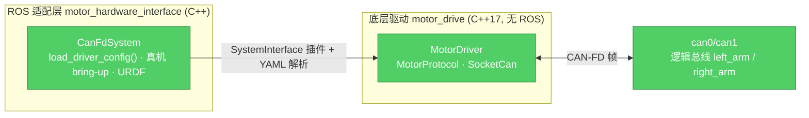

# robot_ws（dev-real：真机转移分支）

14 自由度上半身双臂机器人的 ROS 2 Humble 工作空间，本分支面向**真机部署**：
仅包含 `motor_drive`（底层驱动）与 `motor_hardware_interface`（ros2_control 适配层）
两个 ament 包，不依赖仿真栈。仿真回环与 CANable2 串口台架能力保留在旧 `develop`
分支，两条线各自演进。

[](https://docs.ros.org/en/humble/)
[](https://isocpp.org/)
[](https://www.python.org/)


## Table of Contents

- [特性](#特性)
- [架构](#架构)
- [快速开始](#快速开始)
- [项目结构](#项目结构)
- [配置原则](#配置原则)
- [测试](#测试)
- [开发流程](#开发流程)
- [文档](#文档)
- [License](#license)

## 特性

- **真机 bring-up 自足**：`motor_hardware_interface` 提供 `hardware.launch.py`、
  `driver_controllers.yaml`、CAN-FD ros2_control 硬件片段与内置 `upper_body.urdf.xacro`
  模型；一条命令启动，不依赖模拟器或 Gazebo。
- **配置驱动拓扑**：电机数量、类型、总线与 joint 映射全部由 YAML 声明，底层驱动
  不写死关节数量或左右臂拓扑。
- **协议策略扩展**：内置 RP 系列与 25/30 mm（`motor_2530`）两套协议；新增电机家族时
  实现并注册 `MotorProtocol`，收发主循环无家族分支。
- **安全语义**：激活阶段有界重试（3 × 1 s 窗口）后 fail-fast；运行期反馈超时立即
  终止；总线、电源与标定问题在重新 bring-up 前人工诊断。
- **joints 单一来源**：position controller 的 joints 由 launch 从电机拓扑配置生成并
  注入，不在 `driver_controllers.yaml` 手抄。

## 架构

### 分层与依赖

两个 ament 包构成单向依赖链，无环、无向上依赖：



| 层 | 包 | 语言 | 职责 |
|---|---|---|---|
| ROS 适配 | [motor_hardware_interface](src/motor_hardware_interface/README.md) | C++ | `ros2_control` SystemInterface 插件、YAML 解析、安全时序、真机 bring-up、机器人模型 |
| 底层驱动 | [motor_drive](src/motor_drive/README.md) | C++17 | 与 ROS 解耦的 SocketCAN/CAN-FD 传输与协议策略（`rp` / `motor_2530`） |

### 数据流

**真机链路**：`position_controller`（`/driver` 命名空间）→ `CanFdSystem` →
`MotorDriver` 编码命令帧 → `can0/can1`（CAN-FD，BRS）→ 电机；电机反馈帧经驱动侧
`read()` 解码并更新 joint states。

## 快速开始

### 环境要求

- Ubuntu 22.04
- ROS 2 Humble（`ros2_control`、`controller_manager`、`robot_state_publisher`、`xacro`）
- Linux SocketCAN 内核支持

安装依赖：

```bash
source /opt/ros/humble/setup.bash
rosdep install --from-paths src --ignore-src -r -y
```

### 构建与测试

```bash
source /opt/ros/humble/setup.bash
colcon build --symlink-install
source install/setup.bash
colcon test
colcon test-result --verbose
```

### 真机 bring-up

启动前将两条总线配置为仲裁段 1 Mbit/s、数据段 5 Mbit/s，并启用 CAN-FD BRS：

```bash
sudo ip link set can0 up type can bitrate 1000000 dbitrate 5000000 fd on
sudo ip link set can1 up type can bitrate 1000000 dbitrate 5000000 fd on
```

```bash
ros2 launch motor_hardware_interface hardware.launch.py \
  interface_left_arm:=can0 interface_right_arm:=can1
```

`model_xacro` 默认指向 `motor_hardware_interface/urdf/upper_body.urdf.xacro`；
`interface_<逻辑总线名>` 参数由配置的 `buses` 段自动生成。首次接入时须逐关节确认
零位、方向、限位、增益、反馈超时与硬件急停；仿真参数不能直接替代真机标定。

## 项目结构

```text
.
├── README.md / AGENTS.md / CONTEXT.md   # 工程说明、Agent 指南、领域术语
├── docs/
│   ├── adr/                             # 架构决策记录（ADR 0001–0005）
│   └── health-dashboard-report.md       # 代码健康度报告（只读快照）
└── src/
    ├── motor_drive/                     # 纯 C++17 底层驱动库（SocketCAN + 协议策略）
    └── motor_hardware_interface/        # ros2_control 适配 + 真机入口 + 模型
```

## 配置原则

- **单一配置源**：真机拓扑位于 `motor_hardware_interface/config/motor_canfd.yaml`，
  launch 通过 `motor_joints_from_config()` 生成 position controller 的 joints，
  不手抄关节清单。
- **总线数量任意**：launch 按配置 `buses` 段生成 `interface_<逻辑总线名>` 参数
  （如 `interface_left_arm`），`bus_override.*` 在启动时把逻辑总线映射到任意
  SocketCAN 接口（HIL 时把 vcan 重定向到真实 can 接口）。
- **新增已有类型电机**：只改 YAML 的 `motors` 段。
- **新增电机家族**：在 `motor_drive` 中实现并注册 `MotorProtocol`，并在 YAML 的
  `motor_types` / `motors` 中声明类型与实例；不得在通用收发循环中增加类型分支。
- **安全边界**：激活重试与反馈超时是软件侧兜底，不能替代硬件急停、机械限位与真机标定。

## 测试

当前 58 项用例（GoogleTest + pytest）全部通过，测试不启动 Gazebo 或真实硬件。

| 包 | 测试目标 | 覆盖内容 |
|---|---|---|
| `motor_drive` | `test_protocol` / `test_motor_protocol` / `test_driver` | 协议字段编解码、策略级帧生成/解码、配置校验、协议注册与扩展 |
| `motor_hardware_interface` | `test_motor_config` / `test_canfd_logic` / `test_hardware_launch` | YAML 解析与校验、激活/超时纯逻辑、真机 launch 静态检查 |

## 开发流程

- **分支模型**：`main` 仅用于发布；`dev-real` 是真机转移长期开发线；`develop`
  保留仿真回环与串口台架能力。
- **提交规范**：conventional 前缀（`feat:` / `fix:` / `refactor:` / `docs:` /
  `test:`），正文写清原因。
- **PR 要求**：说明改动内容与验证方式（如 `colcon test` 结果），必要时附行为截图。
- **架构决策**：影响依赖方向、配置边界或安全语义的取舍写入 `docs/adr/`，随功能一起评审。

## 文档

- 领域术语与命名：[CONTEXT.md](CONTEXT.md)
- Agent 开发指南：[AGENTS.md](AGENTS.md)
- 各包说明：见上表包名链接
- 架构决策：[docs/adr/](docs/adr/)
- 代码健康度报告：[docs/health-dashboard-report.md](docs/health-dashboard-report.md)
- 协议手册：`src/motor_drive/docs/` 下的 25–30 mm 驱动与 RP 系列关节 CAN-FD 协议 PDF

## License

Apache-2.0（各包 `package.xml` 声明）。
