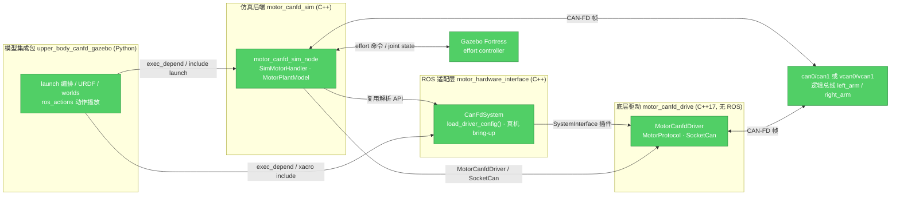

# robot_ws

> 本分支 `dev-sim` 为**仿真线**：四包结构（底层驱动 / ROS 适配层 / 电机侧模拟器 /
> Gazebo 模型集成）+ CANable2 串口台架能力；真机部署线为 `dev-real` 分支。

14 自由度上半身双臂机器人的 ROS 2 Humble 工作空间，覆盖 CAN-FD 电机控制的**仿真回环**与**真机控制**全链路。

[](https://docs.ros.org/en/humble/)
[](https://gazebosim.org/)
[](https://isocpp.org/)
[](https://www.python.org/)


## Table of Contents

- [特性](#特性)
- [架构](#架构)
- [快速开始](#快速开始)
- [项目结构](#项目结构)
- [配置原则](#配置原则)
- [测试](#测试)
- [开发流程](#开发流程)
- [文档](#文档)
- [License](#license)

## 特性

- **完整仿真回环**：ROS 2 position controller → `motor_canfd_drive` → vcan → `motor_canfd_sim` → Gazebo，反馈再经 CAN-FD 帧回到驱动侧，全链路实测可用。
- **真机与仿真解耦**：真机 bring-up 入口由 `motor_hardware_interface` 自足提供，不依赖仿真栈；仿真拓扑配置来源于仿真模型，与真机配置各自演进（ADR 0002）。
- **配置驱动拓扑**：电机数量、类型、总线与 joint 映射全部由 YAML 声明，底层驱动不写死关节数量或左右臂拓扑。
- **协议策略扩展**：新增电机家族时，驱动侧注册 `MotorProtocol`、模拟器侧注册 `SimMotorHandler`，收发主循环无家族分支。
- **安全语义**：激活阶段有界重试（3 × 1 s 窗口）后 fail-fast；运行期反馈超时立即终止；模拟器默认拒绝打开真实 CAN 接口（`allow_hardware_interfaces:=false`）。
- **拓扑一致性测试**：URDF、effort controller、position controller、两侧电机拓扑与动作库的关节顺序互为单一来源，并有静态测试兜底。

## 架构

### 分层与依赖

四个 ament 包构成单向依赖链，无环、无向上依赖：



| 层 | 包 | 语言 | 职责 |
|---|---|---|---|
| 应用集成 | [upper_body_canfd_gazebo](src/upper_body_canfd_gazebo/README.md) | Python | 机器人模型（URDF/xacro）、Gazebo 世界、launch 编排、参考动作播放 |
| 仿真后端 | [motor_canfd_sim](src/motor_canfd_sim/README.md) | C++ | 电机侧模拟器：在 vcan 上扮演电机，驱动 Gazebo effort controller 并编码反馈帧 |
| ROS 适配 | [motor_hardware_interface](src/motor_hardware_interface/README.md) | C++ | `ros2_control` SystemInterface 插件、YAML 解析、安全时序、真机 bring-up 入口 |
| 底层驱动 | [motor_canfd_drive](src/motor_canfd_drive/README.md) | C++17 | 与 ROS 解耦的 SocketCAN/CAN-FD 传输与协议策略（`rp` / `motor_2530`） |

### 数据流

**仿真回环**：`position_controller`（`/driver` 命名空间）→ `CanFdSystem` → `MotorCanfdDriver` 编码命令帧 → vcan → `motor_canfd_sim` 解码并更新 plant model → Gazebo effort controller；Gazebo joint state 经模拟器编码为反馈帧返回驱动侧，驱动侧 `read()` 更新 joint states。

**真机**：同一套「适配层 → 底层驱动」链路，总线为真实 `can0/can1`；模型描述由模型包提供，无 Gazebo/模拟器依赖。

## 快速开始

### 环境要求

- Ubuntu 22.04
- ROS 2 Humble、Gazebo Fortress（`ros_gz`）
- Linux SocketCAN（仿真需要 `vcan` 内核模块）

安装依赖：

```bash
source /opt/ros/humble/setup.bash
rosdep install --from-paths src --ignore-src -r -y
```

### 构建与测试

```bash
source /opt/ros/humble/setup.bash
colcon build --symlink-install
source install/setup.bash
colcon test
colcon test-result --verbose
```

### 全链路仿真

```bash
# 1. 创建 vcan0 / vcan1
bash src/upper_body_canfd_gazebo/scripts/setup_vcan.sh

# 2. 启动完整回环（Gazebo + 模拟器 + 驱动侧 controller）
ros2 launch upper_body_canfd_gazebo driver_loopback.launch.py gui:=false
```

另开终端播放参考动作：

```bash
source install/setup.bash
ros2 run upper_body_canfd_gazebo ros_actions --list
ros2 run upper_body_canfd_gazebo ros_actions --action 8 --speed-scale 0.5
```

### 真机 bring-up

真机启动前必须将两条总线配置为仲裁段 1 Mbit/s、数据段 5 Mbit/s，并启用 CAN-FD BRS。

```bash
ros2 launch motor_hardware_interface hardware.launch.py \
  model_xacro:=src/upper_body_canfd_gazebo/urdf/upper_body.urdf.xacro \
  interface_left_arm:=can0 interface_right_arm:=can1
```

首次接入时须逐关节确认零位、方向、限位、增益、反馈超时与硬件急停；仿真参数不能直接替代真机标定。

## 项目结构

```text
.
├── README.md / AGENTS.md / CONTEXT.md   # 工程说明、Agent 指南、领域术语
├── docs/
│   ├── adr/                             # 架构决策记录（ADR 0001–0004）
│   └── health-dashboard-report.md       # 代码健康度报告（只读快照）
└── src/
    ├── motor_canfd_drive/               # 纯 C++17 底层驱动库
    ├── motor_hardware_interface/        # ros2_control 适配 + 真机入口
    ├── motor_canfd_sim/                 # 电机侧模拟器（唯一仿真后端）
    └── upper_body_canfd_gazebo/         # 模型 / launch / 动作库
```

## 配置原则

- **两份拓扑配置解耦**：[真机配置](src/motor_hardware_interface/config/motor_canfd.yaml) 与[仿真配置](src/motor_canfd_sim/config/motor_canfd.yaml) 各自演进，仅共享 `load_driver_config()` 解析 API（ADR 0002）；同一台机器人的拓扑一致性由静态测试兜底。
- **joints 单一来源**：`driver_controllers.yaml` 不手抄 joints；launch 通过 `motor_joints_from_config()` 从电机拓扑配置生成并注入 position controller。
- **总线数量任意**：launch 按配置 `buses` 段生成 `interface_<逻辑总线名>` 参数（如 `interface_left_arm`），`bus_override.*` 在启动时把逻辑总线映射到任意 SocketCAN 接口（HIL 时把 vcan 重定向到真实 can 接口）。
- **新增已有类型电机**：只改 YAML 的 `motors` 段。
- **新增电机家族**：驱动侧实现并注册 `MotorProtocol`，模拟器侧实现并注册 `SimMotorHandler`，两侧配置声明类型与实例；不得在通用收发循环中增加类型分支。
- **安全边界**：模拟器默认只允许 `vcan*` 接口；真机安全依赖激活重试、反馈超时与人工标定流程，不能替代硬件急停与机械限位。

## 测试

当前 104 项用例（GoogleTest + pytest）全部通过，测试不启动 Gazebo 或真实硬件。

| 包 | 测试目标 | 覆盖内容 |
|---|---|---|
| `motor_canfd_drive` | `test_protocol` / `test_motor_protocol` / `test_driver` | 协议字段编解码、策略级帧生成/解码、配置校验、协议注册与扩展 |
| `motor_hardware_interface` | `test_motor_config` / `test_canfd_logic` / `test_hardware_launch` | YAML 解析与校验、激活/超时纯逻辑、真机 launch 静态检查 |
| `motor_canfd_sim` | `test_plant_model` / `test_sim_frame_decode` / `test_motor_canfd_sim_launch` | plant 模型、帧解析纯函数、launch 参数与安全默认值 |
| `upper_body_canfd_gazebo` | `test_config_topology` 等 5 个 pytest | 拓扑一致性、launch 时序契约、动作库与动作播放器 |

## 开发流程

- **分支模型**：`main` 仅用于发布；功能经 PR 合入 `dev-sim`（仿真线，含串口台架）；
  真机线为 `dev-real`。
- **提交规范**：conventional 前缀（`feat:` / `fix:` / `refactor:` / `docs:` / `test:`），正文写清原因。
- **PR 要求**：说明改动内容与验证方式（如 `colcon test` 结果），必要时附 launch/行为截图。
- **架构决策**：影响依赖方向、配置边界或安全语义的取舍写入 `docs/adr/`，随功能一起评审。

## 文档

- 领域术语与命名：[CONTEXT.md](CONTEXT.md)
- Agent 开发指南：[AGENTS.md](AGENTS.md)
- 各包说明：见上表包名链接
- 架构决策：[docs/adr/](docs/adr/)
- 代码健康度报告：[docs/health-dashboard-report.md](docs/health-dashboard-report.md)
- 协议手册：`src/motor_canfd_sim/` 下的 25–30 mm 驱动与 RP 系列关节 CAN-FD 协议 PDF

## License

Apache-2.0（各包 `package.xml` 声明）。
