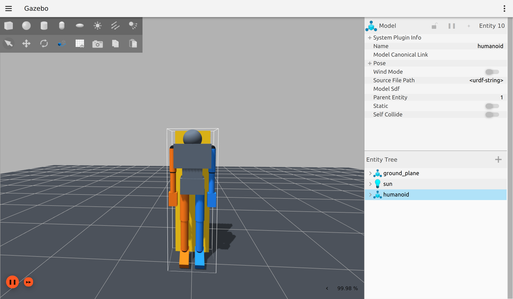

# humanoid_gazebo 验收记录（2026-08-25）

## 结论

单包构建、85 项测试、三路 PTY 节点集成、无头 Gazebo、30 轴状态发布、两个
controller 激活和五类动作均已在本机执行通过。Gazebo GUI 可用并已保存截图。

本机不存在 `/dev/serial/by-id/`，因此物理 USB 串口、USB-CANFD 适配器和 30 分钟外部
控制器耐久测试未执行，不能标记为通过。



## 环境

- 分支：`dev/smi`
- 工作区：`/home/ly/robot_ws`
- ROS 2：Humble
- Gazebo：Fortress / Ignition Gazebo 6
- 渲染：OGRE，X11 `DISPLAY=:0`
- 源码包发现结果：仅 `humanoid_gazebo`

环境 shell 仍带有不存在的 `micro_ros_agent/install` 前缀，colcon 会打印警告；该目录不在
本仓库内，未影响构建、测试或运行。

## 自动化验证

执行：

```bash
source /opt/ros/humble/setup.bash
colcon build --symlink-install
source install/setup.bash
colcon test
colcon test-result --verbose
```

结果：单包构建成功；最终全量结果为 85 tests、0 errors、0 failures、0 skipped。
其中 `test_pty_integration` 执行通过，覆盖：

- 三个真实 PTY slave 分别注入 `left_arm`、`right_arm`、`legs`；
- RP 与 Vaxor 命令经 `SerialTransport` 和节点路由产生非零 30 轴 effort；
- 三条总线均收到节点编码的反馈记录；
- 关闭 `legs` PTY master 后 200 ms 内请求 shutdown，内部末次 effort 为
  30 个零值，且独立 ROS 订阅者在 shutdown 前实际收到 30 轴全零命令。

已有安全测试分别覆盖 150 ms 超时、命令越限、2 ms 重复控制器、错总线和故障锁存。

## Gazebo 运行验收

执行：

```bash
ros2 launch humanoid_gazebo gazebo.launch.py gui:=false
ros2 control list_controllers
ros2 topic echo /joint_states --once
ros2 topic hz /clock
```

观测结果：

- `humanoid` entity 创建成功；`gz_ros2_control` 依次加载 30 个 effort joint；
- `joint_state_broadcaster` 与 `effort_controller` 均为 `active`；
- `/joint_states` 单帧包含 30 个关节；
- `/clock` 在 5004 个样本窗口内平均 1000.104 Hz，最小/最大周期均显示为 0.001 s，
  标准差约 0.00005 s；以 world 的 1 ms step 作为代理，短时 RTF 约为 1.0；
- GUI 右下角显示约 99.98%，机器人、固定支架、地面和左右配色正常可见；
- 约 64 秒无头观测期间未见 controller 退出或 Gazebo 错误。

随后以 `--speed-scale 10` 逐一执行并正常完成：

1. `joint_scan`
2. `shoulder_rhythm`
3. `arm_combo`
4. `suspended_legs`
5. `mirror_check`

## 未执行项

| 检查 | 状态 | 原因 |
|---|---|---|
| 物理 USB CDC/UART 三路连接 | 未执行 | 本机没有 `/dev/serial/by-id/` |
| 物理 USB-CANFD、1/5 Mbit/s、BRS | 未执行 | 本机没有适配器或 CAN-FD 对端 |
| 30 分钟 PTY/外部控制耐久 | 未执行 | 按用户要求快速结束；本次仅完成约 64 秒 Gazebo 现场运行 |
| 物理链路误码、仲裁与终端电阻 | 未执行 | 这些只能在实际 CAN-FD 布线下测量 |

后续接入设备时，应按 `src/humanoid_gazebo/docs/usb-wiring.md` 核对三个稳定端口、
CANH/CANL/GND、两端 120 Ω 终端和协议/ID 唯一性，再补做 30 分钟耐久数据。
