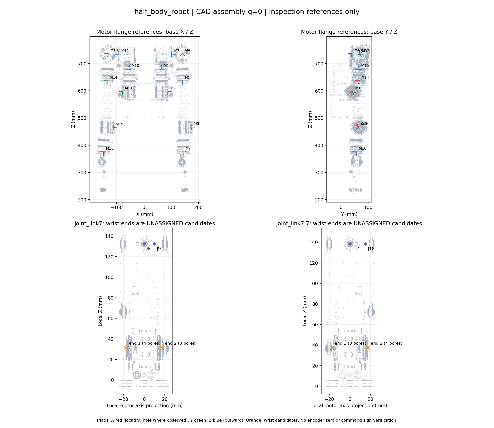

# 半身模型电机关节建系与装配核对

本次在现有模型上建立 **18 个运动关节轴坐标系、14 个巨蟹电机安装基准坐标系、4 个未分配电机编号的腕部端面候选坐标系**。未改写控制用 URDF、传动映射、限位、编码器偏置或在线服务。

当前交付范围按用户要求收敛为 **TF 与电机关系**，见 [motor_tf.yaml](motor_tf.yaml)：覆盖配置中的 18 个电机编号。肩部 M2/M11 标为连杆关系；腕部 M8/M9 共同关联 wrist_a 的两个关节轴 TF，M17/M18 共同关联 wrist_b 的两个关节轴 TF，不将候选端面绑定到电机编号。腕部实体装配和实物零位核对留待后续，不阻塞此关系表交付。

## 基准与适用范围

- 安装端面孔分布圆：R48 Ø40.5 mm、R58 Ø49.5 mm、VAXOR X25S Ø19.8 mm，来自本次提供的三份规格书机械图。
- 电机安装基准原点：输出安装面孔圆中心；Z 朝电机壳体外；观察到唯一 Ø3 定位孔时，X 沿中心指向定位孔，Y = Z × X。定位孔用于确定图纸安装转角基准，不表示编码器零点。
- `joint_link*_axis`：原点保留原运动关节原点，Z 沿现有 URDF 正轴；X 为子连杆 +X 在轴法平面上的投影，近乎平行时用 +Y。它是明确约定的运动轴坐标系，不能把 X 当成定位孔方向。
- `motor_*_mount_reference`：固定在电机安装所在连杆上，是 **q=0 的定子固定安装参考**，不是随电机角度转动的实时输出法兰坐标系。正角遵循原 URDF 右手规则；报告中的同向/反向仅比较几何轴，不能直接写入驱动器方向参数。
- 四个 `*_candidate` 仅是腕部端面候选，无 motor_id；其中一处没有足够孔圆证据，坐标来自另一端加轴向 35 mm 的待核对估计。不可用于控制或作为已验收装配尺寸。
- q=0 保留 SolidWorks 导出装配姿态。所有电机的编码器零位、命令正方向、实际总线 ID 与机械位的对应均未实物验收。没有移动实物或下发任何设备命令。

## 约束、实施与验收

1. 从全分辨率原始 STL 提取共面闭合圆环；在选定端面筛选安装孔，拟合孔分布圆。巨蟹基准至少需要四个独立孔中心，孔圆直径误差及拟合残差均须小于 0.05 mm。
2. 用孔中心所在平面的拟合正常方向确定 Z，保留按电机壳体所在侧选择的朝外符号；用唯一 Ø3 定位孔确定安装转角，否则明确标为未核对。
3. 检查模型只追加 36 个无质量固定参考帧；原有每个 link 和 joint 的定义、网格、惯量、限位全部保持一致。此模型供建系检查，不作为动力学/控制模型替换件。
4. 检查右手性、序列化后的关节轴一致性，以及测量记录对应的源文件 SHA-256。数值是网格几何一致性结果，不代表实物制造/测量精度。

## 装配位置与轴线结果

肩部 M2 / M11 对应连杆驱动。其电机法兰中心距对应运动关节轴约 104.13 mm，轴方向夹角约 87.89°；这个距离是**点到轴距离**，不是两条轴线的最短距离。不能把电机坐标系直接挪到虚拟关节原点，也不能凭此报告认定肩部电机角与关节角一比一。

其余 12 个巨蟹电机与所配置运动关节轴基本共线；本次采用 0.05 mm 点到轴距离、0.1° 轴线夹角作为网格核对阈值。安装端面与原关节原点沿轴相差 0.2–6 mm 的情况属于基准位置不同，不应只改关节 origin 而遗漏连杆几何和惯量变换。本次用独立参考帧表达这些差异。

| 配置电机 ID | 安装连杆 | 孔数 | 孔圆 / mm | 中心到关节轴 / mm | 无向轴夹角 / ° | 沿关节正轴偏移 / mm | 朝外Z与关节正轴 | 定位孔转角 |
|---|---|---:|---:|---:|---:|---:|---|---|
| 1 | base_link | 8 | 40.50001 | 0.00000 | 0.00000 | -0.30000 | 反向 | 已定位 |
| 2 | base_link | 8 | 40.50000 | 104.13046 | 87.88874 | -9.42384 | 同向 | 已定位 |
| 3 | Joint_link2 | 8 | 49.49999 | 0.00015 | 0.00405 | -0.20043 | 同向 | 已定位 |
| 4 | Joint_link3 | 8 | 49.50000 | 0.00273 | 0.02595 | 5.99976 | 同向 | 已定位 |
| 5 | Joint_link4 | 6 | 40.50001 | 0.00003 | 0.00020 | 0.00030 | 反向 | 已定位 |
| 6 | Joint_link5 | 4 | 40.50000 | 0.00015 | 0.00091 | 5.00005 | 同向 | 已定位 |
| 7 | Joint_link6 | 6 | 40.50001 | 0.00005 | 0.00024 | 6.00007 | 反向 | 已定位 |
| 10 | base_link | 8 | 40.50001 | 0.00000 | 0.00000 | 0.20000 | 反向 | 已定位 |
| 11 | base_link | 8 | 40.50000 | 104.13046 | 87.88871 | -9.42382 | 同向 | 已定位 |
| 12 | Joint_link2.2 | 8 | 49.49998 | 0.00002 | 0.03222 | -0.20003 | 同向 | 已定位 |
| 13 | Joint_link3.3 | 8 | 49.50000 | 0.00030 | 0.00277 | 5.99976 | 同向 | 已定位 |
| 14 | Joint_link4.4 | 7 | 40.50002 | 0.00018 | 0.00152 | -0.00012 | 反向 | 已定位 |
| 15 | Joint_link5.5 | 7 | 40.50001 | 0.00007 | 0.00024 | 4.99985 | 同向 | 已定位 |
| 16 | Joint_link6.6 | 6 | 40.50001 | 0.00003 | 0.00020 | -0.00003 | 反向 | 未核对 |

## 腕部与零位待核对项

CAD 组件清单每侧包含两个 VAXOR 组件条目；导出件是合并网格，未保留每个组件的独立变换和装配约束。Ø19.8 的端面在同一轴线两端，间距约 35 mm；仅凭此网格和零件名称，不能区分两台同轴对置电机、一台双出轴电机的两端或重复/简化导出几何。现有 `transmissions.yaml` 配置了每侧两个执行器的差动关系，这不是实物传动关系已经验收的证据。

| 候选端面 | 可见孔数 | 孔圆拟合 / mm | 状态 |
|---|---:|---:|---|
| joint_link7_end_1_candidate | 4 | 19.80002 | 未绑定电机；端面孔圆已识别，装配关系未定 |
| joint_link7_end_2_candidate | 3 | 19.80003 | 未绑定电机；端面孔圆已识别，装配关系未定 |
| joint_link7.7_end_1_candidate | 0 | 无 | 未绑定电机；仅轴向估计，须补装配证据 |
| joint_link7.7_end_2_candidate | 4 | 19.80004 | 未绑定电机；端面孔圆已识别，装配关系未定 |

M16 所在网格未提取出唯一 Ø3 定位孔，孔圆中心和轴向已核对，绕轴转角暂用父连杆轴投影约定；需检查原始 CAD 的定位孔或装配约束后再定安装转角。

完成实物零位验收仍需：确认腕部装配关系及编号；在指定机械参考姿态下读取各电机原始位置，求零位偏置；经专项动作授权后验证命令正方向、连杆/差动换算、限位。此次未执行这些操作。

## 18 个运动关节轴（模型 q=0）

坐标均在 `base_link` 下；位置用 mm，正轴为单位向量。几何零位是当前 CAD 姿态，并不要求左右手臂镜像。

| 关节 | 原点 X / Y / Z（mm） | 正轴 X / Y / Z |
|---|---|---|
| joint_link1 | 64.0000 / 65.5000 / 678.7000 | 0.000000 / 0.000000 / -1.000000 |
| joint_link2 | 70.2050 / 32.9060 / 699.0000 | 0.036840 / -0.999321 / -0.000004 |
| joint_link3 | 102.2800 / 67.4109 / 733.8691 | 0.998508 / 0.036858 / 0.040289 |
| joint_link4 | 141.3168 / 46.3535 / 736.2921 | 0.035301 / -0.998629 / 0.038655 |
| joint_link5 | 142.5157 / 66.0605 / 636.3756 | -0.020468 / 0.037946 / 0.999070 |
| joint_link6 | 168.7065 / 66.4094 / 466.2402 | 0.999168 / 0.036043 / 0.019105 |
| joint_link7 | 143.9257 / 55.6348 / 369.3274 | -0.019415 / 0.008367 / 0.999777 |
| joint_link8 | 158.4884 / 54.9587 / 237.0863 | 0.999168 / 0.036043 / 0.019105 |
| joint_link9 | 142.1430 / 64.3751 / 236.6900 | -0.035876 / 0.999315 / -0.009037 |
| joint_link1.1 | -54.0000 / 65.5000 / 679.2000 | 0.000000 / 0.000000 / -1.000000 |
| joint_link2.2 | -60.2050 / 32.9060 / 699.0000 | -0.036841 / -0.999321 / -0.000004 |
| joint_link3.3 | -92.2796 / 67.4109 / 733.8691 | -0.998534 / 0.036808 / 0.039675 |
| joint_link4.4 | -131.3167 / 46.3517 / 736.2686 | -0.035234 / -0.998615 / 0.039066 |
| joint_link5.5 | -134.1041 / 66.0750 / 636.3874 | 0.036500 / 0.037798 / 0.998619 |
| joint_link6.6 | -117.2135 / 64.7827 / 465.0831 | 0.998712 / -0.036614 / -0.035122 |
| joint_link7.7 | -147.7132 / 56.0336 / 375.6769 | 0.035441 / 0.008220 / 0.999338 |
| joint_link8.8 | -140.6377 / 54.4557 / 236.8472 | 0.998711 / -0.036646 / -0.035114 |
| joint_link9.9 | -157.1620 / 40.0529 / 237.5517 | 0.036314 / 0.999295 / -0.009503 |

## 产物与复核

- [独立建系 URDF](half_body_robot.frames.urdf)：引用现有 `package://robot_description/` 网格；加载前需能解析该包。可用现有 URDF 查看器检查，不要替换运动控制入口。
- [完整坐标、孔中心证据及源文件哈希](measurements.yaml)：长度 m、角度 rad；带 `_mm` / `_deg` 的字段按字段名单位。
- [电机基准表](motor_frames.csv)、[运动关节表](joint_frames.csv)。
- 重生成：在工作空间执行 `python3 ros2_ws/src/robot_description/models/half_body_robot/tools/build_motor_frames.py`。
- 定向检查：`python3 -m pytest -q ros2_ws/src/robot_description/test/test_motor_frames.py`；另用 `check_urdf` 解析检查模型。
- 独立只读审查发现的测试依赖缺失、距离字段歧义已修正，并补了源文件哈希过期检查。

